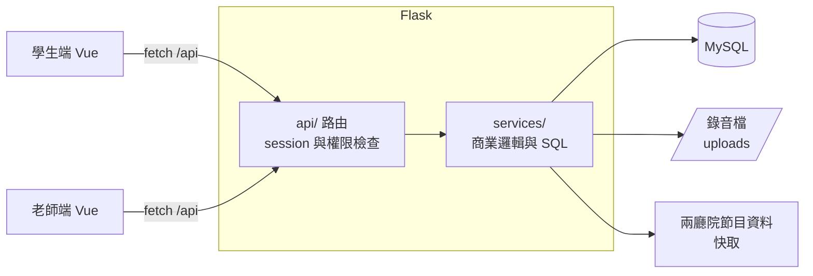

# NoteAdventure 音樂練習冒險

[](https://github.com/AnChen1026/NoteAdventure-music-learning/actions/workflows/test.yml)

給一對一音樂老師的練習管理系統：老師指派練習任務，國小學生上傳練習錄音，完成任務就能獲得 XP 與金幣、養大自己的寵物。

**線上展示**：<https://noteventure-production-5b0d.up.railway.app>

| 角色 | 入口 | 示範帳號 | 密碼 |
|------|------|----------|------|
| 學生（建議橫放手機或用電腦） | [/student](https://noteventure-production-5b0d.up.railway.app/student) | `demo_student` | `demo1234` |
| 老師 | [/teacher](https://noteventure-production-5b0d.up.railway.app/teacher) | `demo@noteadventure.app` | `demo1234` |

> 示範帳號不能修改密碼；你也可以在老師端自行註冊新帳號，建立自己的學生與任務。

---

## 為什麼做這個

我是有 10 年經驗的音樂老師，太太是專門指導國小學生的鋼琴老師。一對一教學最常遇到的問題是：

- **學生回家不練琴**：一週只見一次面，練習狀況只能靠學生（或家長）口頭回報。
- **老師看不到過程**：上課時才發現學生這週幾乎沒碰琴，已經來不及調整。
- **獎勵難以持續**：貼紙、小禮物靠老師手動記帳，學生容易失去動力。

NoteAdventure 把「練習」變成國小學生熟悉的遊戲循環：

```text
任務 → 練習（上傳錄音）→ 進度 → 完成 → 獎勵（XP、金幣）→ 成長（寵物進化、商店兌換）
```

老師則能在後台看到每位學生的練習紀錄並直接試聽錄音。

---

## 功能

**學生端**（Vue 一頁式，16:9 遊戲舞台、背景音樂）

- 主頁地圖導覽：琴房、任務欄、寵物、商店、背包、教室、設定
- 琴房：上傳練習錄音，系統即時更新任務進度並發放獎勵
- 任務欄：每日／每週任務與期限；隱藏任務完成後才出現
- 寵物：依累積 XP 從蛋成長為幼體、成體、稀有型態
- 商店與背包：用金幣購買虛擬或實體獎品
- 教室：串接兩廳院節目資訊，顯示近期音樂演出

**老師端**（Vue 管理後台）

- 建立學生（系統產生帳號與臨時密碼）、重設學生密碼
- 建立任務模板並指派給學生
- 查看學生練習紀錄、線上試聽錄音
- 上架商品、處理實體獎品兌換

---

## 系統架構



- `backend/api/`：只處理 HTTP、session 與參數驗證。
- `backend/services/`：商業邏輯與 SQL，全部使用參數綁定。
- Vue 打包後由 Flask 一併提供，前後端同網域，不需處理 CORS。

詳細資料表見 [docs/DATABASE_SCHEMA.md](docs/DATABASE_SCHEMA.md)，領域用語見 [GLOSSARY.md](GLOSSARY.md)。

---

## 設計重點

**1. 任務模板與任務指派分開**
老師定義一次「每週練習五次」，每次指派給學生都會產生一筆新的任務指派，帶有自己的期限與進度。以 `(學生, 任務, 期間代碼)` 唯一鍵防止同一期重複指派；過期的指派保留歷史，不覆蓋、不歸零。

**2. 發獎不會重複，也不會發一半**
完成任務、加 XP 與金幣、寫入異動紀錄、更新寵物階段放在同一個 transaction。標記完成的 `UPDATE ... WHERE completed = FALSE` 必須真的影響一列，否則整批 rollback——學生同時送出兩次上傳時，只有一次會拿到獎勵。[測試](tests/test_reward_concurrency.py)用兩個執行緒重現這個競態條件。

**3. XP 與金幣同時保存總額與異動紀錄**
學生資料表存目前總額供快速顯示；`xp_source`、`coin_transaction` 記錄每一筆來源（任務獎勵、隱藏任務、購買），可以追查與對帳。

**4. 資料隔離**
老師查詢學生、任務、商品一律限制 `teacher_id`；學生只能存取自己的資料。密碼以 bcrypt 雜湊儲存。

**5. 錄音只存路徑**
音檔存在檔案系統（部署時掛載 volume），資料庫只存路徑與秒數，避免 BLOB 拖慢資料庫。

---

## 技術堆疊

| 類別 | 技術 |
|------|------|
| 後端 | Python 3.12、Flask、PyMySQL、bcrypt、gunicorn |
| 前端 | Vue 3、Vue Router、Vite |
| 資料庫 | MySQL 8.0 |
| 測試 | pytest（使用獨立的 `_test` 資料庫）、GitHub Actions |
| 部署 | Docker、Docker Compose、Railway |

---

## 本機執行

需要 Docker Desktop：

```bash
docker compose up -d --build
```

- 學生：<http://localhost:5000/student>
- 老師：<http://localhost:5000/teacher>（先在老師端註冊帳號）

本機開發、執行測試與 Railway 部署步驟見 [docs/啟動說明.md](docs/啟動說明.md)。

---

## 專案結構

```text
backend/
├── app.py          # Flask Application Factory，提供 API 與 Vue 打包檔
├── api/            # 路由：HTTP、session、權限
├── services/       # 商業邏輯與 SQL
├── sql/            # MySQL schema
├── init_db.py      # 啟動時建表與示範資料
└── demo.py         # 線上展示用示範帳號
frontend/           # Vue 3（學生 /student、老師 /teacher）
material/           # 學生端美術素材與背景音樂
tests/              # pytest
docs/               # 技術文件
```

---

## 已知限制與下一步

**已知技術債**

- 部分 service 失敗時回傳中文字串、成功時回傳資料，回傳型別不一致，之後改為例外或統一結果物件。
- 任務進度計算對每個任務各查一次（N+1），學生任務量大時可改為一次彙總查詢。
- 任務條件目前實作「練習次數」與「不同曲目數」兩種；練習天數、連續天數等規則已在 schema 預留。
- 老師端尚未提供任務與商品的修改、刪除、停用。

**下一步**

- **錄音分析**：上傳後分析音高與節奏，產生新的任務條件（例如「這首曲子節奏穩定度達 80%」）。
- **寵物動畫**：寵物進化時的動畫回饋。
- **家長視角**：讓家長看到孩子的練習紀錄。

---

## 關於

個人專案。最初為資展期中專題，之後獨立重構為 Vue 3 前端、分層後端、自動化測試與雲端部署。
學生端美術圖片由 AI 生成。
